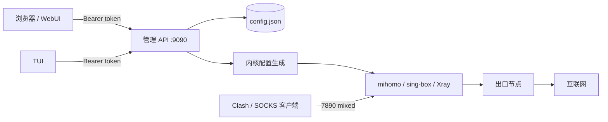

# LocalMedia Unlock

LocalMedia Unlock 是一个运行在 Linux 上的流媒体分流解锁管理器。它把代理内核（mihomo、sing-box 或 Xray）的配置、节点、分流规则和入站端口集中到一个本地管理界面，适合在 NAS、迷你主机或 VPS 上部署。

> 本项目只管理代理内核和分流配置，不提供代理节点，也不绕过服务方的账号、地区或版权限制。请遵守当地法律与你所使用的服务条款。

## 功能

- 管理 mihomo、sing-box、Xray 三种内核的配置与内核进程启动/停止。
- 通过 Web UI 或 TUI 管理流媒体与 AI 服务分流规则。
- 导入节点 URI 或 URI/base64 订阅列表，并按服务选择出口。
- 默认提供 mixed 入站（HTTP/SOCKS），可配置 socks/http 入站和代理认证。
- 管理 API 使用长期令牌，默认只监听本机。
- 订阅 token 与后台管理 token 分离，便于给客户端下发配置。
- 支持源码构建、systemd 与 Docker 部署。

## 架构



控制器与代理内核是分离的两个进程。控制器负责持久化配置、生成内核配置并拉起内核；真正的代理流量由内核处理。更多细节见 [架构说明](docs/architecture.md) 和 [内核安装](docs/kernels.md)。

## 快速开始

### 方式一：源码运行

要求 Go 1.24 或更新版本（开发与测试使用 Go 1.26）。

```bash
git clone https://github.com/DoriyaNet/LocalMedia-Unlock.git
cd localmedia-unlock
make build
./bin/localmedia-unlock serve --config .local/config.json
```

浏览器打开 <http://127.0.0.1:9090>。首次启动会创建配置文件并生成管理令牌。读取令牌：

```bash
python3 - <<'PY'
import json
with open('.local/config.json') as f:
    print(json.load(f)['settings']['adminToken'])
PY
```

没有 `python3` 时也可以直接查看 JSON 中的 `settings.adminToken`。不要把该令牌粘贴到公开 issue 或聊天记录中。

源码运行不会自动安装代理内核；请先按 [内核安装](docs/kernels.md) 准备 mihomo、sing-box 或 Xray。

需同时存放运行时内核配置时，指定独立数据目录：

```bash
./bin/localmedia-unlock serve \
  --config .local/config.json \
  --data-dir .local/state \
  --listen 127.0.0.1:9090
```

`serve` 默认监听 `127.0.0.1:9090`；`--listen` 覆盖配置中的管理地址。TUI 连接已运行的管理 API：

```bash
./bin/localmedia-unlock tui \
  --api http://127.0.0.1:9090 \
  --token "$LOCALMEDIA_ADMIN_TOKEN"
```

### 方式二：systemd 安装

在已安装 Go（用于源码 fallback）或可访问 GitHub Release 的 Linux 主机上执行：

```bash
sudo ./scripts/install.sh
```

默认安装位置：

| 内容 | 路径 |
| --- | --- |
| 二进制 | `/usr/local/bin/localmedia-unlock` |
| 安装前缀 | `/opt/localmedia-unlock` |
| 配置 | `/etc/localmedia-unlock/config.json` |
| 环境变量 | `/etc/localmedia-unlock/localmedia-unlock.env` |
| 数据与运行时配置 | `/var/lib/localmedia-unlock` |
| systemd 单元 | `/etc/systemd/system/localmedia-unlock.service` |

脚本会检测 `amd64`/`arm64`，在设置 `REPO` 后优先下载 release，失败时回退到 `go build`；未设置 `REPO` 时直接源码构建。安装可重复执行：已有 `config.json` 和环境文件不会被覆盖。

常用变量：

```bash
sudo PREFIX=/opt/localmedia-unlock \
  CONFIG_DIR=/etc/localmedia-unlock \
  LOCALMEDIA_VERSION=v0.1.0 \
  ./scripts/install.sh
```

- `REPO=owner/repo`：release 所在仓库。
- `LOCALMEDIA_VERSION=latest`：也可指定 tag。
- `LOCALMEDIA_BIN=/path/to/binary`：使用已构建的二进制。
- `BIN_DIR=/usr/local/bin`：二进制安装目录。
- `DATA_DIR=/var/lib/localmedia-unlock`：运行时数据目录。
- `INIT_LISTEN=127.0.0.1:19091`：首次生成配置时使用的临时本机端口。
- `SKIP_SYSTEMD=1`：只安装文件，不启用服务。
- `NO_START=1`：安装后不启动服务。

安装脚本不会自动下载或安装代理内核。

查看状态与日志：

```bash
sudo systemctl status localmedia-unlock
sudo journalctl -u localmedia-unlock -f
```

### 方式三：Docker

镜像只包含控制器，不包含 mihomo、sing-box 或 Xray。

```bash
docker compose build
mkdir -p data
# 让容器内的非 root UID 65532 能写配置和运行时目录
sudo chown -R 65532:65532 data
docker compose up -d
```

示例 compose 只把管理端口和代理端口发布到宿主机回环地址：

- Web UI/API：`http://127.0.0.1:9090`
- mixed 代理：`127.0.0.1:7890`

这会创建 `./data`，但不会自动创建 `./kernels`。如果需要容器内运行内核：

```bash
mkdir -p kernels
# 把已校验的 Linux 内核二进制放进去，例如 kernels/mihomo
```

然后在 `docker-compose.yml` 的 `environment` 中设置：

```yaml
environment:
  LOCALMEDIA_MIHOMO_BIN: /opt/kernels/mihomo
  LOCALMEDIA_SINGBOX_BIN: /opt/kernels/sing-box
  LOCALMEDIA_XRAY_BIN: /opt/kernels/xray
```

也可以把宿主机 systemd 安装作为控制器运行方式；Docker 容器内的网络、权限和内核调试通常比宿主机模式复杂。

若要让局域网客户端直接访问容器代理端口，可将 compose 中 `7890` 的映射改为 `7890:7890`，同时保持管理端口仅回环，并确认防火墙、入站认证和 `allowLan` 配置符合你的网络边界。

## 首次配置

1. 打开 Web UI，输入配置中的 `settings.adminToken`（或启动时用 `--token`/`LOCALMEDIA_ADMIN_TOKEN` 覆盖的令牌）。
2. 在“系统设置”选择内核，并确认内核路径。
3. 在“出口节点”导入一个或多个节点。
4. 在“入站 / 客户端”确认 mixed 端口和代理认证。
5. 在“分流规则”把 Netflix、Disney+ 等服务指向对应出口。
6. 启动内核，使用客户端连接 `127.0.0.1:7890` 验证。

## 客户端接入

### Clash / Mihomo

如果使用 Clash Verge、Mihomo Party 等客户端，把代理服务器设为控制器所在主机的 IP，端口设为入站端口（默认 `7890`），类型选择 HTTP 或 SOCKS5。启用代理认证时填写“入站 / 客户端”页面的用户名和密码。

Xray 没有原生 mixed 入站：选择 Xray 时，配置中的 mixed 端口用于 SOCKS5，HTTP 使用紧邻的下一个端口（例如 `7890`/`7891`）。Web UI 的概览会显示这两个实际监听地址；其他内核对同一端口同时提供 HTTP 和 SOCKS5。

如果 Web UI 提供了订阅链接，也可以把订阅地址添加到支持 Clash 订阅的客户端；订阅 token 与后台 token 不同，泄露订阅 token 不会直接获得管理权限。

### 命令行测试

```bash
# HTTP 代理
curl --proxy http://127.0.0.1:7890 https://www.gstatic.com/generate_204

# SOCKS5（无认证时）
curl --socks5-hostname 127.0.0.1:7890 https://www.gstatic.com/generate_204
```

启用认证时，curl 使用 `--proxy-user user:password`。不要把密码写进 shell 历史；可以交互输入或使用临时环境变量。

如果内核正在运行但连接失败，先在“概览”查看内核状态与日志，再检查入站监听地址。默认 mixed 监听 `0.0.0.0:7890`，“允许局域网”默认开启；如果只在本机使用，建议关闭“允许局域网”或把入站监听改为 `127.0.0.1`。

## 节点导入

出口节点页面支持单个节点 URI 导入。可用的协议类型由实际解析器与内核能力决定；导入后请先保存并启动内核，查看内核是否接受生成的配置。

如果导入订阅，支持每行一个分享 URI，或对这些 URI 做 base64 编码的订阅文本；不解析 Clash YAML 订阅。节点会追加到现有列表；重名（包括重复导入）会自动追加 ` (2)`、` (3)` 后缀。节点密码、UUID、REALITY 参数等属于敏感信息，导出配置时只应保存在受控位置。

## 分流设置

内置服务预设包括 Netflix、Disney+、Hulu、Max、Prime Video、Paramount+、Peacock、Crunchyroll、YouTube、Spotify、TikTok、哔哩哔哩、ChatGPT、Claude、Gemini、GitHub 和 Telegram。

每条预设路由有：

- 服务：预设域名集合。
- 出口：`direct` 或已启用的节点。
- 启用：关闭后不参与分流。

自定义规则可以填写域名列表，并选择目标出口。默认情况下未命中预设规则或自定义规则的流量走“系统设置 → 默认出口”。保存配置时若内核正在运行，控制器会重新生成并校验配置，再重启内核应用新配置；如果新配置校验失败，旧内核保持运行，错误会返回给界面，便于修正。

## 内核与订阅

控制器不自动下载内核。安装路径、权限和 Docker 挂载方式见 [内核安装](docs/kernels.md)。

解析内核路径的优先级：

1. `LOCALMEDIA_MIHOMO_BIN` / `LOCALMEDIA_SINGBOX_BIN` / `LOCALMEDIA_XRAY_BIN`
2. `config.json` 中的 `settings.kernelPaths`
3. `PATH` 中的 `mihomo` / `sing-box` / `xray`

环境变量优先于配置文件，重启控制器后生效。配置文件中保存的是 `kernelPaths`（不存在单独的 `coreBin` 字段）。

## 管理 API

默认地址是 `http://127.0.0.1:9090`。API 使用 Bearer token；不要把管理端口直接暴露到公网。

健康检查不需要鉴权：

```bash
curl -i http://127.0.0.1:9090/healthz
```

读取配置（不会返回 `adminToken`；认证后仍会返回订阅 token，供 Web UI 复制订阅链接）：

```bash
curl -H "Authorization: Bearer $LOCALMEDIA_ADMIN_TOKEN" \
  http://127.0.0.1:9090/api/v1/config
```

具体路由以实际入口代码为准；常用接口包括：

- `GET /api/v1/auth/status`：检查是否需要管理令牌。
- `GET /api/v1/config`：读取脱敏配置。
- `GET /api/v1/status`：读取控制器与内核状态。
- `PUT /api/v1/routes`：更新分流规则。
- `POST /api/v1/outbounds/import`：导入节点 URI。
- `POST /api/v1/controller/start`、`/api/v1/controller/stop`、`/api/v1/controller/restart`：控制内核。

管理接口接受 `X-Admin-Token` 或 `Authorization: Bearer <token>`。修改类接口要求 `Content-Type: application/json`，并支持可选的 `If-Match`：`GET /api/v1/config` 会返回 `ETag`，带上它可避免多个浏览器或 TUI 覆盖彼此的修改；不带该头仍兼容单客户端使用。`GET /api/v1/config/export` 会导出包含敏感配置的完整 JSON；`GET /api/v1/subscription` 返回带订阅 token 的链接，只能在受控环境中调用。

公开订阅路径为 `GET /sub/<subscriptionToken>`，仅在当前内核为 Mihomo 时输出 Clash YAML。

`GET /api/v1/core` 返回当前内核二进制的可用性与版本。节点测试接口 `POST /api/v1/outbounds/{id}/test` 只测服务器 TCP 可达性，不代表代理协议或流媒体解锁结果；`POST /api/v1/controller/test` 则通过实际入站发起一次探测请求。

## 环境变量

systemd 安装会加载 `/etc/localmedia-unlock/localmedia-unlock.env`（文件不存在时忽略）。可用的覆盖项：

| 变量 | 说明 |
| --- | --- |
| `LOCALMEDIA_ADMIN_TOKEN` | 覆盖管理令牌 |
| `LOCALMEDIA_ADMIN_TOKEN_FILE` | 从文件读取管理令牌 |
| `LOCALMEDIA_DATA_DIR` | 数据目录（默认 `/var/lib/localmedia-unlock`） |
| `LOCALMEDIA_LISTEN` | 管理 API 监听地址 |
| `LOCALMEDIA_MIHOMO_BIN` | mihomo 二进制路径 |
| `LOCALMEDIA_SINGBOX_BIN` | sing-box 二进制路径 |
| `LOCALMEDIA_XRAY_BIN` | Xray 二进制路径 |

管理令牌也可以通过启动参数 `--token` 提供；不要在共享终端里把令牌作为命令行参数长期保留。

## 安全注意事项

- 管理 API 默认监听 `127.0.0.1`。不要无鉴权地把 `9090` 暴露到公网；如确需远程访问，使用 SSH 隧道或带 TLS 和访问控制的反向代理。
- `config.json` 包含管理 token、代理密码和节点凭据。安装脚本把配置目录与文件归属 `localmedia`，目录权限 `0750`、配置文件权限 `0600`；不要把权限放宽到 `0777` 或让 other 用户可读。
- 代理入站默认监听 `0.0.0.0:7890`。在不可信网络中应改成 `127.0.0.1`，或启用代理认证并配置防火墙。
- 不要使用 `--allow-insecure`/跳过证书校验来“修复”所有连接问题；这会削弱 TLS 校验。
- 只从可信来源安装内核，并验证 release 的校验和或签名。
- Docker 默认丢弃全部 capability，并以非 root 用户运行。若内核需要额外权限或访问宿主机网络，优先使用宿主机 systemd 模式，仔细评估后再调整。

## 故障排查

### 服务无法启动

```bash
sudo systemctl status localmedia-unlock
sudo journalctl -u localmedia-unlock -n 100 --no-pager
```

常见原因：配置目录不可写、二进制路径错误、配置文件 JSON 损坏、systemd 单元中的 `ExecStart` 与实际安装路径不一致。

### 内核启动失败

查看日志中的“内核配置生成/校验”错误。确认：

- 当前选择的内核与已安装版本匹配。
- 环境变量或 `kernelPaths` 指向可执行文件。
- 二进制对 `localmedia` 用户可执行。
- 内核支持配置中启用的协议、传输和 TLS 选项。

### 端口被占用

```bash
sudo ss -lntp | grep -E ':9090|:7890'
```

可以修改管理端口（`--listen`）或入站端口（Web UI），然后重启对应进程。修改管理端口后，systemd 单元和环境文件中的参数也需要同步。

### 忘记管理令牌

在主机上以 root 读取：

```bash
sudo sed -n 's/.*"adminToken"[[:space:]]*:[[:space:]]*"\([^"]*\)".*/\1/p' \
  /etc/localmedia-unlock/config.json
```

如果使用 `LOCALMEDIA_ADMIN_TOKEN` 覆盖，则以环境变量为准。不要在日志或工单中粘贴令牌。

## 卸载

```bash
sudo ./scripts/uninstall.sh
```

默认保留 `/etc/localmedia-unlock` 与 `/var/lib/localmedia-unlock`，只移除程序、systemd 单元和服务用户。彻底删除：

```bash
sudo ./scripts/uninstall.sh --purge
```

如果安装时修改了 `PREFIX`、`CONFIG_DIR` 或 `DATA_DIR`，卸载时传入相同的变量，避免删错路径。

## 开发

```bash
make fmt
make vet
make test
make build
make smoke
```

`make smoke` 会在临时目录启动真实二进制，检查 `/healthz`、未认证 401、认证后的配置、状态与鉴权状态；不需要代理内核。Linux 交叉构建：

```bash
make build-linux
```

生成 linux/amd64 与 linux/arm64 二进制到 `dist/`。发布 release 时请附带校验和，并保持安装脚本的资产命名一致。

## 许可证与致谢

本项目不附带代理内核。mihomo、sing-box、Xray 及其依赖分别遵循各自的上游许可证；分发或再发布时请遵守对应许可证和商标要求。


