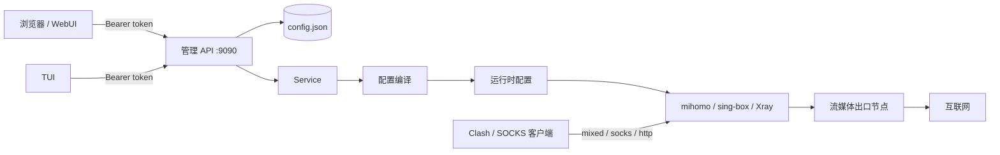

# 架构说明

LocalMedia Unlock 是一个本机优先的流媒体分流控制器。它本身不实现代理协议，也不把 mihomo、sing-box 或 Xray 打包进镜像；它负责保存配置、生成可被内核识别的配置、启动/停止内核，以及提供管理界面。

## 进程与数据流



### 管理面

- 默认监听 `127.0.0.1:9090`，也支持启动参数 `--listen` 覆盖。
- Web UI 和 API 使用同一个管理令牌。令牌来自 `settings.adminToken`，也可以用 `--token`、`--token-file` 或 `LOCALMEDIA_ADMIN_TOKEN`/`LOCALMEDIA_ADMIN_TOKEN_FILE` 覆盖；启动时指定的令牌会保存回配置。
- 配置包含管理令牌与代理密码，必须限制文件权限；不要放进公开仓库。

### 数据面

- 默认入站为 `0.0.0.0:7890` 的 mixed 端口；客户端可以使用 HTTP 代理或 SOCKS5。
- 分流规则按域名后缀/精确域名/关键字匹配，将不同服务的流量送到不同出口。
- `direct` 是内置直连出口，不能被删除。
- 启用代理认证时，客户端需要提供配置中的代理用户名和密码。

### 内核生命周期

控制器将配置编译为当前内核的格式，再调用对应二进制：

- mihomo：`-f <config>`
- sing-box：`run -c <config>`
- Xray：`run -config <config>`

控制器的 `DataDir/runtime` 目录需要可写；systemd 安装默认把它设为 `/var/lib/localmedia-unlock/runtime`。

## 部署边界

```mermaid
flowchart TB
    subgraph Host
        Systemd[systemd / Docker] --> Process[localmedia-unlock]
        Process --> Runtime[/var/lib/localmedia-unlock]
        Process --> Config[/etc/localmedia-unlock/config.json]
        Process --> Kernel[(系统内核二进制)]
    end
    Kernel --> Proxy[7890 入站]
    Process --> UI[9090 管理面]
```

安装脚本只安装控制器与 systemd 单元，不会替用户下载或验证代理内核。这样可以把“控制面升级”和“网络代理组件升级”分开，也避免未经确认的第三方二进制进入系统。

## 权限模型

- 服务用户：`localmedia`，无登录 shell。
- 配置目录：`0750 localmedia:localmedia`，目录必须可写，因为控制器通过原子 rename 保存配置。
- 配置文件：`0600 localmedia:localmedia`；程序保存时使用 `0600` 临时文件后替换。
- 数据目录：`0750 localmedia:localmedia`。
- systemd：`NoNewPrivileges=true`、`ProtectSystem=strict`、`CapabilityBoundingSet=`，默认不授予额外 capability。

如果修改管理端口到特权端口（小于 1024），需要另行配置 capability；默认的 `9090` 和 `7890` 不需要 root 权限。

